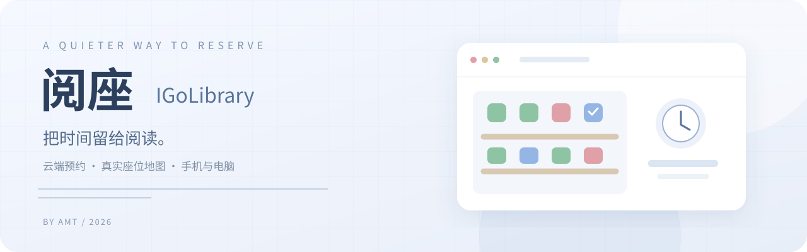

# 阅座 · 我去图书馆 API 在线预约抢座

**在浏览器里安排座位，把准点执行交给服务器。**

[打开阅座](https://114.55.61.254/) · [免费申请账号](https://github.com/AMT-J/IGoLibrary/security/advisories/new) · [使用指南](docs/使用指南.md) · [反馈问题](https://github.com/AMT-J/IGoLibrary/issues/new?template=bug_report.yml)

申请与使用前请阅读 **[免责声明](DISCLAIMER.md)**。

---

## 项目简介

阅座是一款面向图书馆座位系统的预约辅助服务，支持场馆查询、座位地图、候选座位排序和定时预约。用户提前设置计划，服务器在指定时间执行，并保存结果和过程记录。

项目采用浏览器交互与后台任务独立运行的方式。手机和电脑均可管理计划，无需安装客户端，也无需保持本地设备在线。

**访问地址：[https://114.55.61.254/](https://114.55.61.254/)**

当前适配通过微信授权的 **Traceint（我去图书馆）** 座位系统。不同学校的接口、开放时间和规则可能不同，申请时可以说明学校，是否可用以实际登录和场馆返回为准。这是个人维护的项目，与学校及平台没有官方合作关系。

## 免费账号申请

服务免费提供。受当前服务器 CPU 性能限制，**最多开放 10 人**。

1. 登录 GitHub，打开 [私密申请入口](https://github.com/AMT-J/IGoLibrary/security/advisories/new)。
2. 标题填写 `[账号申请]`，选择“账号申请”，在正文说明申请意向；学校名称为可选信息。
3. 有空余名额时，我会在**同一条私密对话**中回复用户号和密码。满额后申请进入等待。
4. 收到账号后，打开网页，输入用户号，验证密码并完成本人学校微信授权。

账号申请与凭据发放均在私密对话内完成，不会作为公开 Issue 展示。请保持报告私密，不要将包含账号密码的内容发布为公开公告。

GitHub 使用私密安全报告功能提供这个入口，表单已区分“账号申请”和“安全问题”。

## 功能

| 功能 | 使用时的表现 |
| --- | --- |
| 实际座位地图 | 按学校返回的坐标显示座位和设施，空闲、占用、选中分别着色；支持缩放、拖动和查找座位号。 |
| 候选座位顺序 | 在地图上选择最多 5 个候选座位，可以调整先后顺序；先选座位不可用时，继续尝试后面的候选座位。 |
| 定时预约 | 设置执行日期、时间和重复规则，支持仅这一次、每天、周一至周五。 |
| 独立账号执行 | 每个账号保存自己的授权、计划和记录，后台独立执行，可在相同时间预约。 |
| 授权覆盖判断 | 总览结合 Cookie 到期时间与最近一次计划，显示能否覆盖；不足时，给出何时之后重新登录预计可覆盖。 |
| 执行结果 | 抢座结束后统一显示成功或失败、座位号、耗时，以及学校实际返回的排队位次；没有返回位次时显示未记录。 |
| 记录分开查看 | 当前计划、预约执行记录、维持座位记录分别展示，可以查看一次执行的详细过程。 |
| 维持座位 | 管理员允许后，用户可单独开启；程序在已有成功持座、临近签到期限时判断是否处理原座。 |
| 手机与电脑 | 自适应布局，自定义场馆、日期、时间和重复规则选择器；手机 Safari 也能使用。 |
| 后台持续运行 | 提交成功的计划保存在服务器上，关闭网页或退出网页会话后，计划继续执行。 |

网页的自动更新会在抢座执行期间暂停，把资源留给抢座；结束后再读取并展示结果。**不会向微信、邮箱或其他渠道发送额外抢座通知**，学校原有的消息不受影响。

## 快速开始

### 1 · 验证用户号

打开 [阅座](https://114.55.61.254/)，输入用户号和密码。用户号密码验证和学校授权是两步：通过第一步后，仍需登录自己的学校账号才能管理预约。

### 2 · 完成学校微信授权

进入账户页，按页面提示使用二维码或微信授权按钮。授权后，复制学校返回的**完整回跳链接**，粘贴到网页的授权输入框并提交。

电脑端可以用手机微信扫描二维码；手机端可使用打开微信、复制授权入口等操作。微信和浏览器对跳转的支持有差异，自动打开失败时，按页面提供的复制方式在微信里打开即可。

链接中的授权码通常只能使用一次。导入失败时先看页面反馈；如果提示已使用或失效，重新授权获取新链接。**不要把这个链接粘贴到 GitHub Issue。**

首次成功登录会将用户号绑定到对应的学校账号。后续更新授权继续使用同一个学校账号，不能用别人的授权链接覆盖。

### 3 · 在地图上选座，建立计划

进入场馆选座，选择场馆，在地图上点击候选座位，安排好顺序，再设置执行日期、时间和重复规则。保存后，到预约计划页确认计划已出现、时间和候选座位都正确。

**页面里的时间都是北京时间（UTC+8）。执行日期是服务器发起抢座的日期，不一定等于入馆日期。** 当前预约流程在执行日提交次日预约；例如 10 月 14 日 22:00 执行，对应申请 10 月 15 日的座位。开放时刻和可预约日期仍按学校规则判断。

### 4 · 看总览，确认授权能覆盖

总览显示最近一次执行时间与授权覆盖情况。出现“可覆盖”时，当前授权可以覆盖这次执行；不能覆盖时，根据页面给出的登录时间建议，在抢座前更新授权。

网页只能根据已知到期时间估计覆盖情况。如果学校提前使授权失效，仍需要重新登录。

### 5 · 执行结束后查看结果

保持用户号验证与学校授权有效，执行结束后总览会自动更新。成功时显示座位号和耗时；失败时查看学校反馈与详细记录。“结果待核实”表示服务器还不能确认最终结果，需结合学校预约记录核对，不能当作成功。

更多操作、维护开关和常见问题见 **[完整使用指南](docs/使用指南.md)**。

## 运行环境

用户端仅需现代浏览器和微信，无额外运行环境要求。

| 一侧 | 当前环境 |
| --- | --- |
| 手机 | iOS Safari、Android 的现代浏览器；微信用于学校授权。 |
| 电脑 | Chrome、Edge、Safari 等现代浏览器；手机微信可配合扫码。 |
| 服务器 | 阿里云 ECS，2 vCPU / 2 GiB，Ubuntu 26.04 LTS。 |
| 执行程序 | Linux 上的独立预约进程；服务器校时，账号独立计划，共享时间校准与调优参数。 |
| 网页入口 | HTTPS，经过代理限流、连接限制和异常访问防护。 |

本仓库暂时不提供源码、安装包或自行部署教程。服务已经部署，使用时直接访问网页即可。

## 数据与访问边界

网页用户只能管理自己绑定账号的计划、授权状态和执行记录。账号密码管理、全体用户档案、服务器设置与系统管理由管理员在 SSH 中处理，公网没有管理员菜单。

授权信息在服务器端用于执行预约；浏览器会话凭证只保存在当前页面内存中。不要把账号借给别人，也不要在公共设备上留下已登录页面。页面重新加载后需重新验证，已保存计划仍在后台运行。

异常访问达到防护条件时，公网网页入口会关闭，并保持关闭状态，等待管理员检查后恢复。关闭网页入口不会主动停止后台预约和维持座位进程。大流量攻击如果触发云厂商的网络封禁，仍可能影响服务器与学校之间的通信；应用层防护不能保证这类情况下继续抢座。

## 使用约束

完整说明见 **[免责声明](DISCLAIMER.md)**。

- 使用自己的学校账号，遵守所在图书馆的预约、签到和退座规则。
- 能否预约成功受座位竞争、学校排队、接口状态和授权有效期影响，无法保证成功。
- 维持座位需要管理员单独开放，开启后是否执行由当前持座状态和学校规则决定；它不代替正常签到。
- 学校规则或接口调整时可能需要修复，我会在仓库更新情况。
- 遇到问题可以提交 [问题反馈](https://github.com/AMT-J/IGoLibrary/issues/new?template=bug_report.yml)，截图和日志先去掉个人信息。

## 关于开源

**项目目前闭源。** 本仓库提供项目介绍、使用文档和 Issue 申请入口，暂不发布实现代码。

计划在 **2027 年暑假前**，利用空闲时间完成代码整理后开源。具体发布时间取决于整理进度，后续将在本仓库更新。

---

**AMT | © 2026 All Rights Reserved**

[开始使用](https://114.55.61.254/) · [私密申请账号](https://github.com/AMT-J/IGoLibrary/security/advisories/new)

